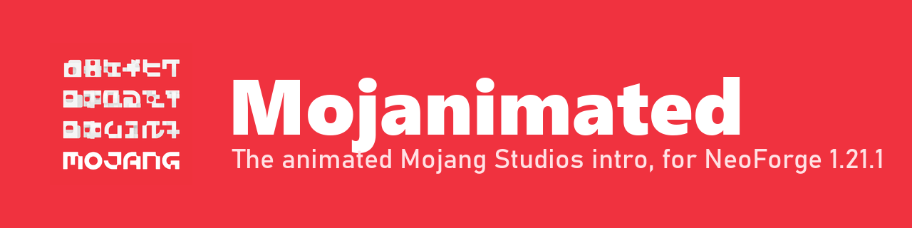
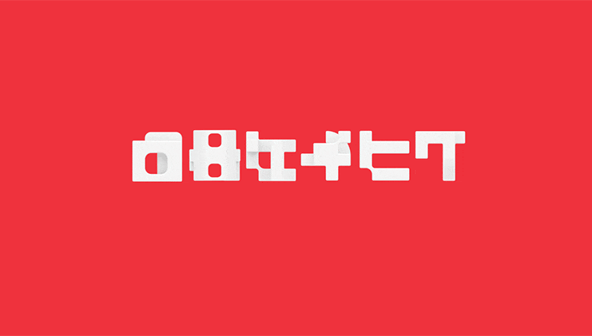

<p align="center"></p>

<p align="center">
  
  
  
  
</p>

**Mojanimated** plays the animated Mojang Studios logo (as seen in Minecraft Dungeons and Minecraft Live) with its jingle on the loading screen of Minecraft 1.21.1 with NeoForge.

<p align="center"></p>

## Features

- **Startup intro.** The progress bar shows while the game loads, then the letters tumble into place with the jingle and "Studios" fades in before your title screen appears.
- **Resource pack reloads.** On F3+T or the pack screen, the letters loop silently until loading finishes, then settle on "MOJANG".
- **Friendly to other mods.** It hooks the vanilla loading screen without replacing it, so FancyMenu layouts, Quick Pack and other loading-screen mods keep working. Works with NeoForge's `earlyWindowControl = false`.
- **Configurable in-game** through the NeoForge config screen (or Configured): startup intro, jingle, reload animation and logo hold time. File: `config/mojanimated-client.toml`.

Client-side only. Don't use it together with Animated Mojang Logo, since both replace the same logo.

## Bugs and ideas

Please post them in **[Issues](https://github.com/SteelArchadian/Mojanimated/issues)**. That's where every report gets read and tracked, rather than in CurseForge or Modrinth comments.

## Building

```
./gradlew build
```

The jar is written to `build/libs/`. `./gradlew runClient` starts a dev client with a test harness (`src/harness`, never packaged) that launches minimized, captures loading-screen screenshots to `run/captures`, triggers a resource reload and quits.

## Credits and license

Animation frames, jingle and timing come from **[Animated Mojang Logo](https://github.com/BouncingElf10/Animated-Mojang-Logo)** by **BouncingElf10** (GPL-3.0-or-later). Thank you! The Mojang Studios logo and jingle belong to Mojang Studios / Microsoft. This is an unofficial fan mod. See [CREDITS.md](CREDITS.md).

Code: GPL-3.0-or-later, see [LICENSE](LICENSE). Made for the Foundation modpack, with help from Claude.
